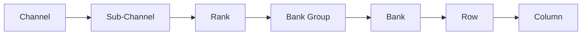

DDR5 SDRAM is the fifth generation of the JEDEC Double Data Rate standard, defined in [JESD79-5](https://www.jedec.org/standards-documents/docs/jesd79-5) (first published July 2020) [[1](#ref-1)].

## Organization

| Feature | Value | Source |
|---|---|---|
| Standard | JESD79-5 (July 2020) | [JEDEC press release](https://www.jedec.org/news/pressreleases/jedec-publishes-new-ddr5-standard-advancing-next-generation-high-performance) [[1](#ref-1)] |
| Data rates | 3200–6400 MT/s (up to 8800 in later revisions) | [Grokipedia JEDEC summary](https://grokipedia.com/page/JEDEC) [[2](#ref-2)] |
| Channel layout | Two independent 32-bit sub-channels per DIMM | [Micron DDR5 white paper](https://assets.micron.com/adobe/assets/urn:aaid:aem:5ea148c8-e3fe-489e-8489-99b1b9cdcd3c/renditions/original/as/ddr5-new-features-white-paper.pdf) [[3](#ref-3)] |
| Prefetch | 16n | [EcrioniX DDR guide](https://ecrionix.org/protocols/ddr/) [[4](#ref-4)] |
| Die densities | 8 Gb, 16 Gb, 24 Gb, 32 Gb | [Micron 128GB RDIMM product brief](https://assets.micron.com/adobe/assets/urn:aaid:aem:6ffd17ac-e709-469d-9473-a0a904681dd9/renditions/original/as/128gb-ddr5-rdimm-product-brief.pdf) [[5](#ref-5)] |

## Hierarchy

## Timings

| Timing | Page |
|---|---|
| `tRFC` — Refresh Cycle Time | [tRFC](trfc/) |

## Sources

1. JEDEC — [JESD79-5 DDR5 standard page & press release](https://www.jedec.org/news/pressreleases/jedec-publishes-new-ddr5-standard-advancing-next-generation-high-performance)
2. Grokipedia — [JEDEC memory technology specifications](https://grokipedia.com/page/JEDEC)
3. Micron — [DDR5 SDRAM: New Features white paper](https://assets.micron.com/adobe/assets/urn:aaid:aem:5ea148c8-e3fe-489e-8489-99b1b9cdcd3c/renditions/original/as/ddr5-new-features-white-paper.pdf)
4. EcrioniX — [DDR & LPDDR Memory Protocol Guide](https://ecrionix.org/protocols/ddr/)
5. Micron — [128GB DDR5 RDIMM product brief](https://assets.micron.com/adobe/assets/urn:aaid:aem:6ffd17ac-e709-469d-9473-a0a904681dd9/renditions/original/as/128gb-ddr5-rdimm-product-brief.pdf)

*Licensed under [CC BY 4.0](https://creativecommons.org/licenses/by/4.0/).*
