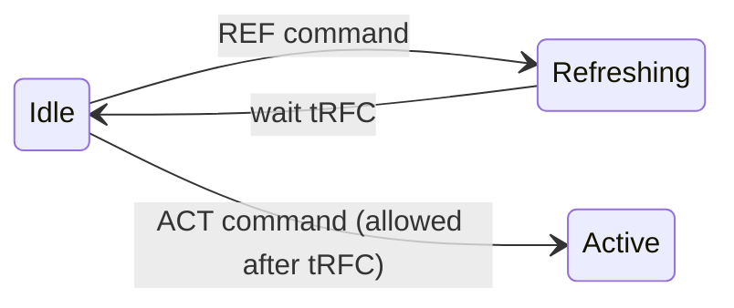

# `tRFC` — Refresh Cycle Time ([DDR5](/dram/ddr5/))

## What it means

DRAM stores each bit (`1` or `0`) as a tiny electric charge in a capacitor. That charge slowly leaks away, so the chip must regularly pause and recharge its cells or the data is lost [[1](#ref-1)].

**`tRFC` (Refresh Cycle Time)** is the minimum time a refresh pause takes, from the `REFRESH` command until the refreshed banks can accept a new `ACTIVATE` (`ACT`) command [[1](#ref-1), [2](#ref-2)]. While a bank is refreshing, it cannot be read or written.

Why is `tRFC` longer on bigger chips? A larger die (32 Gb vs. 8 Gb) has more rows to recharge in each refresh, so the pause takes more time [[1](#ref-1)].

## The three DDR5 refresh modes

- **`tRFC1` (Normal Refresh):** pauses **all banks** in the rank (`REFab`), issued once every `3.9 µs` (`tREFI`) [[1](#ref-1)].
- **`tRFC2` (Fine Granularity Refresh):** a shorter pause for **all banks** (`REFab`), issued twice as often [[2](#ref-2), [3](#ref-3)].
- **`tRFCsb` (Same-Bank Refresh):** refreshes **one bank number** in every bank group (`REFsb`) while the other banks keep working [[1](#ref-1), [3](#ref-3)].

## Bank states

All target banks must be closed (`Idle`) before a refresh starts [[1](#ref-1)].

## Waveform

After a `REFab` command, the memory controller must wait at least `tRFC` before sending `ACT` [[1](#ref-1)]:

## Values by chip capacity

| Chip capacity (per die) | `tRFC1` (Normal) | `tRFC2` (Fine Granularity) | `tRFCsb` (Same-Bank) |
|---|---|---|---|
| **8 Gb** | 195 ns [[1](#ref-1), [4](#ref-4)] | 130 ns [[4](#ref-4)] | 115 ns [[1](#ref-1), [4](#ref-4)] |
| **16 Gb** | 295 ns [[1](#ref-1), [2](#ref-2), [4](#ref-4)] | 160 ns [[2](#ref-2), [4](#ref-4)] | 130 ns [[1](#ref-1), [2](#ref-2), [4](#ref-4)] |
| **24 Gb** | 410 ns [[1](#ref-1), [5](#ref-5)] | 220 ns [[5](#ref-5)] | 190 ns [[1](#ref-1), [5](#ref-5)] |
| **32 Gb** | 410 ns [[1](#ref-1), [3](#ref-3)] | 220 ns [[3](#ref-3)] | 190 ns [[1](#ref-1), [3](#ref-3)] |

## Cross-references

- Technology: [DDR5](/dram/ddr5/)
- Planned related timings: `tREFI` (refresh interval), `tRP` (row precharge), `tRC` (row cycle)

## Sources

1. CMU SAFARI — [Ramulator 2.0 DDR5 specification (`python/ramulator/dram/ddr5.py`)](https://github.com/CMU-SAFARI/ramulator2/blob/main/python/ramulator/dram/ddr5.py)
2. The Open Memory Initiative — [spdr DDR5 SPD numerical claims (`docs/numerical-claims.md`, SPD bytes 42–47)](https://github.com/The-Open-Memory-Initiative-OMI/spdr/blob/main/docs/numerical-claims.md)
3. Micron — [128GB DDR5 RDIMM product brief (32 Gb die, JESD79-5B compliant)](https://assets.micron.com/adobe/assets/urn:aaid:aem:6ffd17ac-e709-469d-9473-a0a904681dd9/renditions/original/as/128gb-ddr5-rdimm-product-brief.pdf)
4. Innodisk — [DDR5 SDRAM datasheet Rev. 1.0, July 2023 (8 Gb and 16 Gb timing table)](https://www.mouser.com/datasheet/2/1415/Innodisk_M5S0_AGM2NAVP-3317558.pdf)
5. G.SKILL — [F5-6000J4048F24GX2-TZ5NR 24 Gb DDR5 specification sheet](https://www.gskill.com/_upload/files/F5-6000J4048F24GX2-TZ5NR.pdf)

*Licensed under [CC BY 4.0](https://creativecommons.org/licenses/by/4.0/).*
